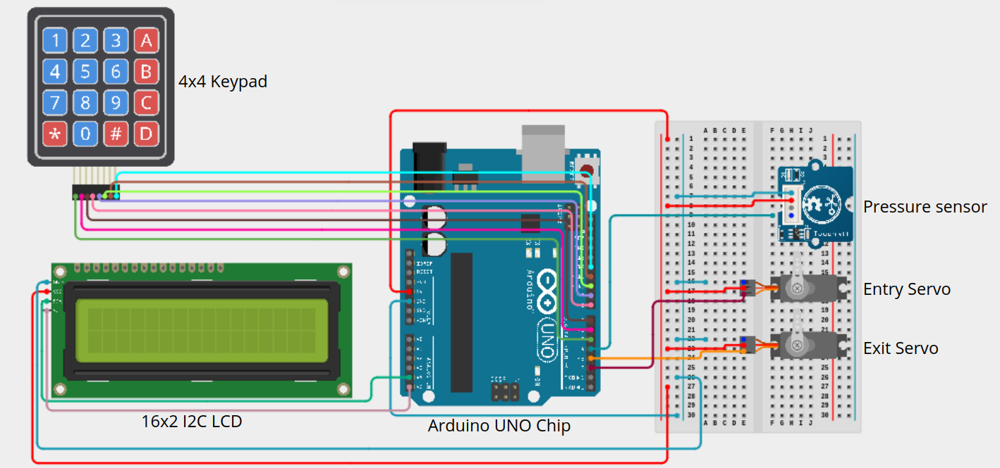

# Automatic Piggy Bank (Arduino)
 
A beginner Arduino project: a piggy bank that detects a coin being inserted, asks for its value on a keypad, keeps a running total, and opens to let you take the money out.
 
## Background
 
This project was originally built at the start of my second year of prepa. The original files were lost, so I rebuilt the system by simulating an Arduino UNO and its components on `cirkitdesigner.com`. The software was therefore entirely rewritten from my memory of the features implemented in the original project.
 
## How it works
 
1. **Idle**: the screen displays a welcome message.
2. **Coin insertion**: the sensor (pin 4) detects the coin and the screen asks for its value.
3. **Keypad input**: keys 1 to 5 and 7 to 9 correspond to the 1c, 2c, 5c, 10c, 20c, 50c, €1 and €2 coins. Key `6` switches between the two menu pages, and `A` cancels.
4. **Registration**: the entry servo opens to let the coin through, the amount is added to the total, then the total is displayed for 2 seconds.
5. **Key `A`** (when idle): displays the total, press `A` again to go back.
6. **Key `D`**: the exit servo opens the piggy bank so you can take the money, and `A` closes it and resets the total to zero.

## Circuit
 

 
## Hardware (simulated)
 
- Arduino UNO board
- 16x2 LCD with I2C module (address `0x27`)
- 4x4 matrix keypad
- 2 servo motors (entry hatch and exit hatch)
- 1 pressure sensor (coin detection)

### Pinout
 
| Component | Pin |
|---|---|
| Entry servo | 2 |
| Exit servo | 3 |
| Pressure sensor | 4 |
| Keypad, rows R1 to R4 | 5, 6, 7, 8 |
| Keypad, columns C1 to C4 | 9, 10, 11, 12 |
| LCD (I2C) | SDA / SCL |
 
## Libraries
 
- `Servo`
- `LiquidCrystal_I2C`
- `Keypad`

## Usage
 
1. Install the libraries above (Arduino IDE Library Manager).
2. Open `sketch.ino`, then compile and upload it to the board, or load it in a simulator with the circuit described above.

## Possible improvements
 
- Replace the blocking waits with a state machine.
- Add debouncing on the sensor.
- Test on real hardware.

