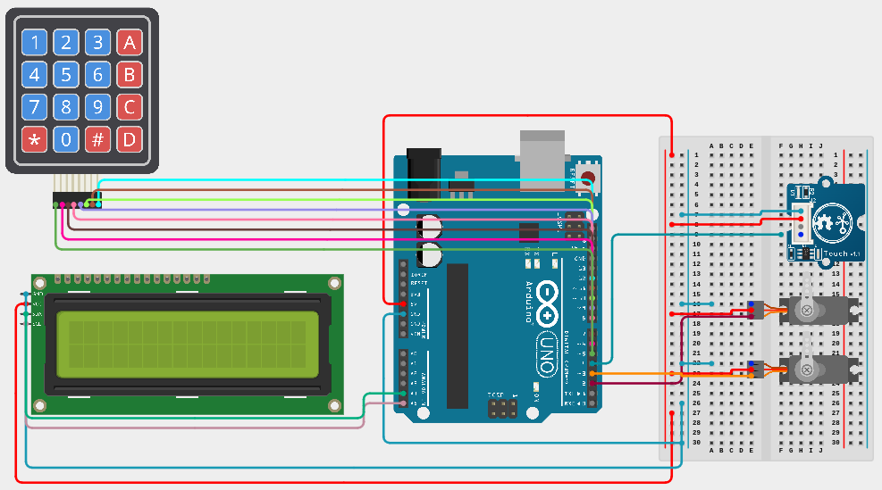

# Tirelire automatique (Arduino)
 
Projet de prise en main d'Arduino : une tirelire qui détecte l'insertion d'une pièce, demande sa valeur au clavier, additionne le total, et s'ouvre pour récupérer l'argent.
 
## Contexte
 
Projet réalisé en début de première année de prépa intégrée. Les fichiers ayant été perdus, j'ai refait le système en simulant la carte Arduino UNO et les différents composants sur le simulateur `cirkitdesigner.com`. Le software a donc entièrement été refait à partir de mes souvenirs des fonctionnalités ayant été implémentées lors du projet initial.
 
## Fonctionnement
 
1. **Au repos**, l'écran affiche un message d'accueil.
2. **Insertion d'une pièce** : le capteur (broche 4) la détecte, l'écran demande sa valeur.
3. **Saisie au clavier** : les touches 1 à 5 et 7 à 9 correspondent aux pièces de 1c, 2c, 5c, 10c, 20c, 50c, 1€ et 2€. La touche `6` bascule entre les deux pages du menu, `A` annule.
4. **Enregistrement** : le servo d'entrée s'ouvre pour laisser passer la pièce, le montant est ajouté au total, puis le total s'affiche 2 secondes.
5. **Touche `A`** (au repos) : affiche le total, `A` pour revenir.
6. **Touche `D`** : le servo de sortie ouvre la tirelire pour récupérer l'argent, `A` la referme et remet le total à zéro.

## Montage

## Matériel (simulé)
 
- Carte Arduino UNO
- Écran LCD 16x2 avec module I2C (adresse `0x27`)
- Clavier matriciel 4x4
- 2 servomoteurs (trappe d'entrée et trappe de sortie)
- 1 capteur de pression (détection de pièce)

### Brochage
 
| Élément | Broche |
|---|---|
| Servo d'entrée | 2 |
| Servo de sortie | 3 |
| Capteur de pression | 4 |
| Clavier, lignes R1 à R4 | 5, 6, 7, 8 |
| Clavier, colonnes C1 à C4 | 9, 10, 11, 12 |
| LCD (I2C) | SDA / SCL |
 
## Bibliothèques
 
- `Servo`
- `LiquidCrystal_I2C`
- `Keypad`

## Utilisation
 
1. Installer les bibliothèques ci-dessus (gestionnaire de bibliothèques de l'IDE Arduino).
2. Ouvrir `sketch.ino`, compiler et téléverser sur la carte, ou le charger dans un simulateur avec le montage décrit plus haut.

## Pistes d'amélioration
 
- Remplacer les attentes bloquantes par une machine à états.
- Ajouter un anti-rebond sur le capteur.
- Tester sur du matériel réel.
